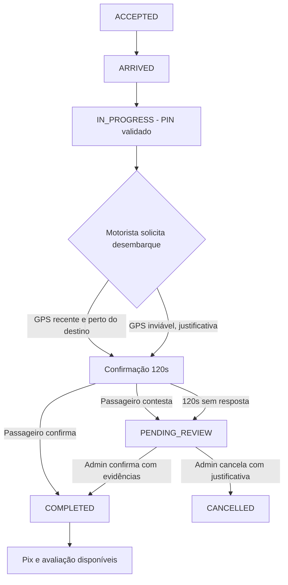

# CARONAA F07 — RN020 | Encerramento seguro de Corrida Rápida

**Situação:** proposta implementada em branch, condicionada à migration manual 0210.
**Escopo:** Corrida Rápida (carro/moto), sem alterar caronas agendadas.

## 1. Princípio central
Encerramento do transporte, confirmação do desembarque, avaliação,
cobrança Pix e comprovação de recebimento são eventos independentes.

- Somente **passageiro confirmando** (ou administrador decidindo após revisão)
  transforma a viagem em `COMPLETED`.
- Silêncio, GPS não verificável e contestação **nunca** representam consentimento,
  prova de pagamento ou direito de cobrança automática.
- O banco, não o frontend, é autoridade dos estados e valores.
- Pagamento Pix é manual e não comprovado por leitura de QR ou clique do usuário.
- Enquanto `PENDING_REVIEW`, não há QR Pix ou comissão de plataforma.

## 2. Máquina de estados

## 3. Responsabilidades e evidências
| Evento | Quem autoriza | Pré-condição | Efeito |
|---|---|---|---|
| Solicitar desembarque com GPS | Motorista autenticado | `IN_PROGRESS`, embarque confirmado; GPS <=150m e <=90s; distância ao destino <= max(150m, min(250m, precisão+100m)) | Cria apenas **uma** janela de resposta de 120s |
| Exceção GPS | Mesmo motorista, justificativa de 20–1000 caracteres | `IN_PROGRESS` e embarque confirmado | Abre a mesma janela; sem conclusão unilateral |
| Confirmar desembarque | Passageiro autenticado, dentro do prazo | `IN_PROGRESS`, revisão aberta e não resolvida | `COMPLETED` + comissão se contrato tarifário válido; Pix liberado para visualização |
| Contestar desembarque | Passageiro autenticado, dentro do prazo | Idêntica | `PENDING_REVIEW`; sem cobrança; libera operação |
| Silêncio até 120s | Reconciliador autenticado do próprio pedido | Prazo vencido, sem resposta e sem decisão | `PENDING_REVIEW`; sem cobrança; libera operação |
| Decisão administrativa | Usuário com papel admin; motivo 20–2000 caracteres | Revisão resolvida, não decidida, sem auditoria anterior | Conclui ou cancela; registro imutável de decisão |

## 4. Regras de idempotência e concorrência
- Chamadas repetidas de solicitação **não renovam** o prazo da revisão.
- Resposta do passageiro e timeout usam locks da mesma viagem/revisão.
- Após resposta ou decisão não é possível reabrir o encerramento pelo fluxo comum.
- Evento `quick_ride_completion_events` tem chave única por viagem/tipo de evento.
- Comissão mantém trigger existente apenas na transição para `COMPLETED`.
- A migração não apaga viagens, pagamentos, avaliações ou repasses anteriores.

## 5. Experiência mobile-first
**Motorista:** solicita confirmação perto do destino; caso o GPS falhe,
escolhe "Solicitar confirmação manual" e justifica. Durante a janela
vê o relógio. Em `PENDING_REVIEW` recebe informação clara e pode
trabalhar em novas corridas se habilitado.

**Passageiro:** recebe "Já desembarcou?" com Confirmar e Contestar.
Não há confirmação presumida. No timeout ou contestação, vê
"Encerramento em análise", sem Pix. Após conclusão confirmada,
recebe Pix/avaliação opcional sem bloquear o app.

**Admin:** fila de revisões inclui contestadas, silêncio e exceção GPS,
com justificativa, distância/precisão quando houver e registro de decisão.

## 6. Financeiro
- `COMPLETED` não significa `PAID`; é o encerramento confirmado do serviço.
- QR Pix usa exclusivamente o snapshot de tarifa da viagem no servidor.
- Declaração do passageiro e confirmação do motorista são registros bilaterais;
  nenhum substitui conciliação bancária automática.
- Em `PENDING_REVIEW`, Pix e comissão ainda não são devidos pelo sistema.
- Uma decisão administrativa de conclusão desbloqueia o financeiro no
  instante da transição, sem preencher artificialmente valores ou comprovantes.

## 7. Homologação após migration 0210
1. Corrida real com GPS próximo do destino, passageiro confirma em até 120s
   -> `COMPLETED`, 1 comissão, tela de Pix e avaliação para os dois.
2. Passageiro contesta -> `PENDING_REVIEW`, sem Pix/comissão,
   admin decide com justificativa e auditoria, motorista liberado.
3. Passageiro não responde -> `PENDING_REVIEW` após prazo,
   sem Pix/comissão e sem botão de confirmar depois do prazo.
4. Motorista pede 2 ou mais vezes -> mesmo prazo, sem reinício do relógio.
5. GPS ausente ou longe -> solicitação normal negada; opção manual abre
   confirmação ao passageiro e **não** conclui imediatamente.
6. Refresh, troca de aba e reconexão -> status recuperado de
   `quick_ride_my_requests`; uma disputa não prende o motorista.
7. Usuário não autorizado, corrida já finalizada, resposta duplicada ou
   administração sem papel -> operações negadas, sem mutação.
8. Falha de acesso ao banco -> não marcar como concluído localmente.
9. Validar cobrança somente após `COMPLETED`; pagamentos não são duplicados.

## 8. Operação e limite conhecido
A migration **0210_f07_safe_dropoff_completion_and_review.sql** precisa ser
aplicada manualmente em Supabase SQL Editor, antes de publicar o frontend.
O prazo é reconciliado por chamadas dos participantes a
`quick_ride_my_requests` e pela RPC de timeout. Se ambos os aparelhos
ficarem totalmente offline, o registro é reconciliado quando alguém voltar
ao app. Um worker de backend agendado, com autenticação de serviço e logs
auditáveis, pode ser adicionado em fase separada para garantir execução
pontual independentemente de sessões ativas.
